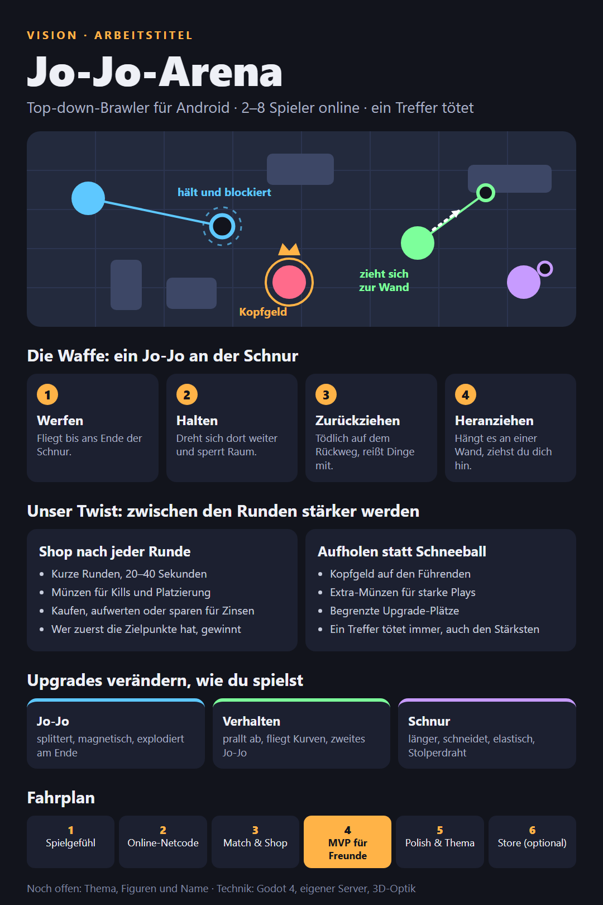

# Spinback Rumble

(Working title until version 0.5: "Slice n Dice"; the repository and the file names keep the old name.)

A top-down arena brawler for Android with online multiplayer for 2-8 players. Fast rounds where one hit kills, and the weapon is a yo-yo you throw, leave spinning, retract or pull yourself towards.



The picture is the original German vision sketch.

## Status

Early prototype, milestone 1 (game feel offline). See [docs/PLAN.md](docs/PLAN.md) for the full plan.

## Install and update (testers)

Test versions are published in
[the releases of this repository](https://github.com/Dr-Nerdlove/project-slice-n-dice/releases). On an Android phone:
download the `.apk` of the newest release, open it and allow installing from this source. From version 0.3.0 on
the app tells you by itself ("New version ... available" in the main menu, with a download button; also in Settings) when a
newer version exists; installing it over the old one keeps your settings. The check sends nothing about you.
Versions before 0.2.1 have to be uninstalled once.
Versions up to 0.16.1 looked for updates in the former releases repository Joni9993/slice-n-dice-releases; the
first release after the move is published there as well, so they find it by themselves.

## Working on it

- Engine: Godot 4.7.2. The Godot project is in `game/`.
- Run on PC:

  ```
  godot --path game
  ```

- Build an Android debug APK:

  ```
  godot --headless --path game --export-debug "Android" ../build/slice-n-dice-debug.apk
  ```

  This needs the Godot export templates, JDK 17 and the Android SDK, configured in Godot's editor settings.

- Run the automated tests (needs `godot` on the PATH; about a minute):

  ```
  tests/run.sh
  ```

  `python3 tests/sabotage.py` checks that the tests really catch deliberate breakage (in temporary copies,
  parallel, a few minutes; your files are never touched). GitHub Actions runs the tests on every push and pull
  request and builds the debug APK (download it from the run's artifacts); it also scans the whole git history
  for secrets (gitleaks).

## Main menu: Play and Training

The app starts on the main menu: **Play**, **Training** and **Settings** (version, update).

- **Play** is the real game and always uses the fixed standard values (never the tuned ones). Choose your figure,
  then **Solo vs bots** or **Together** (below). During a round only a small pause button is shown.
- **Training** is the sandbox: the tuning sliders, the modifier levels, bots, the **Online** page and the lag tool,
  with your saved values. The gear (or Escape / Android back) opens the tuning menu; **Main menu** leaves.

## Playing locally (one phone hosts)

No server needed: everybody must be in the same Wi-Fi, or in the hotspot of one of the phones.

- **Host:** switch on the Wi-Fi connection or the phone's hotspot yourself (the app cannot do that), open
  **Play > Together**, **Host a game**. The page shows a short code. The match uses the standard values and no
  modifiers, and ends when the host leaves or closes the app.
- **Guests:** open **Play > Together**; the game appears under **Games found**, press it. If the list stays empty
  (some networks block broadcasts), type the code and press **Join**.

## Playing online (experiment)

The first netcode experiment: a headless server on a PC, 2-4 phones on the same network.

- Start the server (UDP port 24565 by default; `--bots` fills the free slots with bots):

  ```
  godot --headless --path game -- --server [--port 24565] [--bots]
  ```

  It prints joins and leaves and a status line every 10 seconds. Allow the port in the PC's firewall.
- On the phone: start Training, press the gear, page **Online**, type the PC's address (`name` or `address:port`),
  **Verbinden**. The sliders on that page add artificial delay (per direction, so the ping grows by twice that value)
  and packet loss, and the switch **Gegner glätten** (on: the other players are drawn smoothly, a little in the past;
  off: the raw prediction, to compare); the HUD shows ping, correction, open inputs and the delay of the others.
- Check a running server without a display: `godot --headless --path game -s tests/net_probe.gd -- HOST[:PORT]`.

The Android build has the INTERNET permission enabled for this (and, for local play, the permissions to read the
Wi-Fi state and to receive broadcasts).

## Releases

Add a section `## X.Y.Z` to `CHANGELOG.md`, then push the tag `vX.Y.Z`: the workflow
`.github/workflows/release.yml` tests, builds and publishes the APK to the releases repository above (details in
`AGENTS.md`, "Release"). `tools/set-version.sh X.Y.Z` sets the version number in the project files.

## Licence

GNU AGPL v3, see [LICENSE](LICENSE).
